# Loader Lab

30 original loading animations built in pure HTML and CSS. Zero JavaScript dependencies for animation, GPU-accelerated strictly with `transform` and `opacity`, and controlled via CSS variables.

[](LICENSE)
[](#)
[](#)

---

## Previews

### Desktop Showcase (Dark / Light)
| Dark Mode | Light Mode |
|---|---|
| 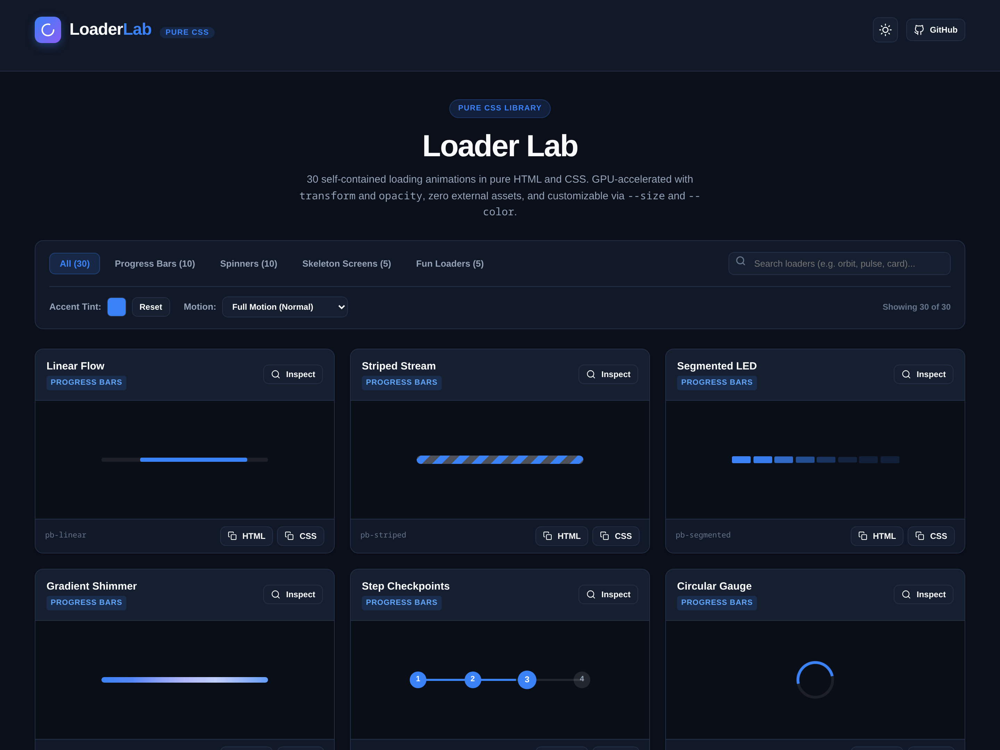 | 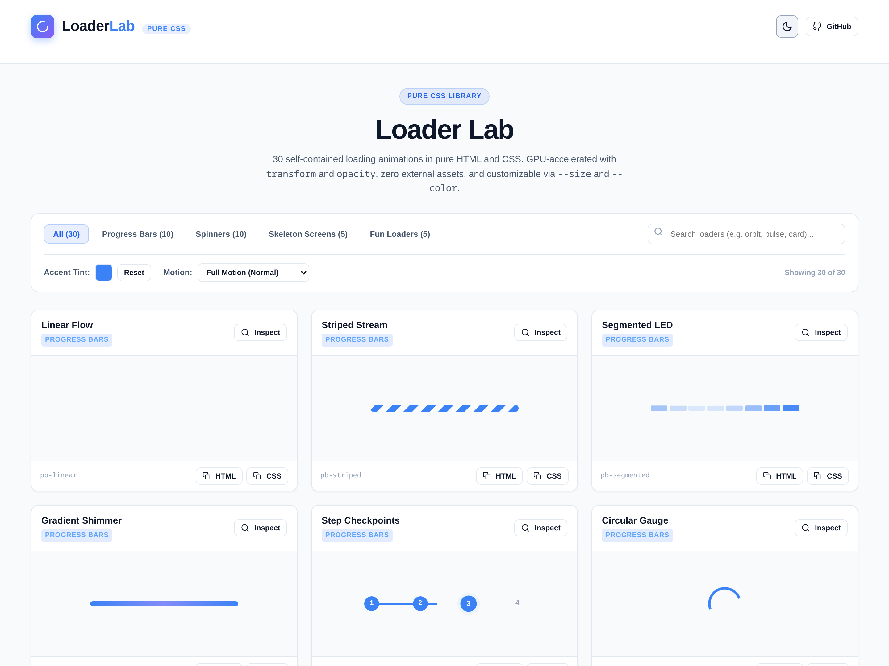 |

### Mobile View & Code Inspector
| Mobile Responsive Grid | Live Inspector Modal |
|---|---|
| 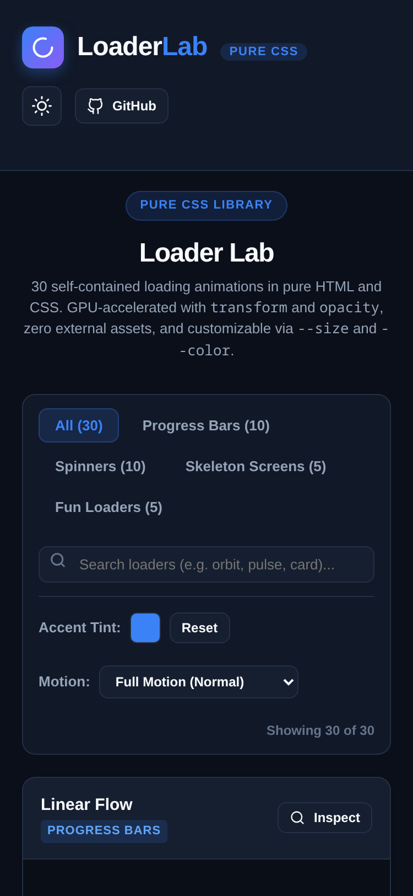 | 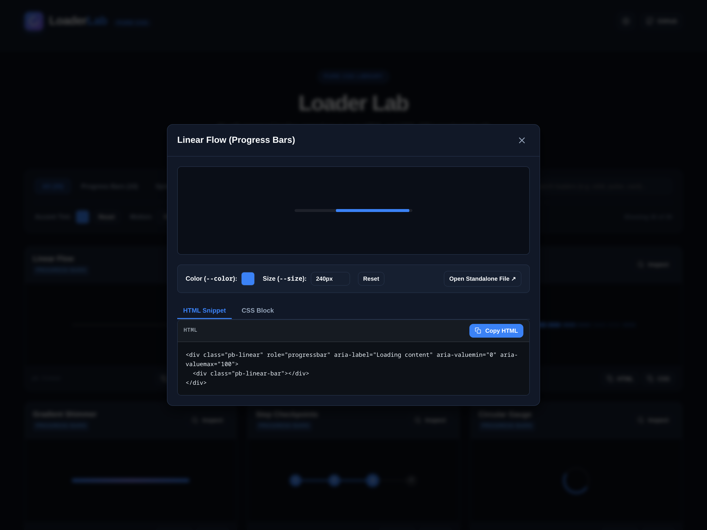 |

---

## Design Principles

- **One HTML block + One CSS block**: Self-contained snippets. No external fonts, no SVG files, no icon dependencies.
- **Controlled by Two Variables**: Primary size is controlled by `--size`, and accent color is controlled by `--color`.
- **Hardware-Accelerated (60 FPS)**: Every animation manipulates only `transform` and `opacity` to avoid layout thrashing and paint bottlenecks.
- **Accessible**: Comprehensive `@media (prefers-reduced-motion: reduce)` fallbacks across all 30 loaders.
- **Responsive**: Adapts from 320px screens up to 4K displays.

---

## Quick Start

### 1. Standalone Snippet
Copy the HTML and CSS directly from any file in [`loaders/`](loaders/):

```html
<!-- HTML -->
<div class="pb-linear" role="progressbar" aria-label="Loading content" aria-valuemin="0" aria-valuemax="100">
  <div class="pb-linear-bar"></div>
</div>
```

```css
/* CSS */
.pb-linear {
  --size: 240px;
  --color: #3b82f6;
  --track: rgba(255, 255, 255, 0.08);
  --height: 6px;
  width: var(--size);
  max-width: 100%;
  height: var(--height);
  background: var(--track);
  border-radius: 9999px;
  position: relative;
  overflow: hidden;
}

.pb-linear-bar {
  position: absolute;
  top: 0;
  left: 0;
  height: 100%;
  width: 100%;
  background: var(--color);
  border-radius: 9999px;
  transform-origin: left center;
  animation: pbLinear 1.6s cubic-bezier(0.65, 0, 0.35, 1) infinite;
}

@keyframes pbLinear {
  0% { transform: translateX(-100%) scaleX(0.2); }
  50% { transform: translateX(25%) scaleX(0.65); }
  100% { transform: translateX(200%) scaleX(0.2); }
}

@media (prefers-reduced-motion: reduce) {
  .pb-linear-bar {
    animation: none;
    transform: translateX(0) scaleX(0.6);
  }
}
```

### 2. Consolidated Stylesheet
Import `dist/loaders.css` to access all 30 classes at once:

```html
<link rel="stylesheet" href="dist/loaders.css">

<!-- Use any loader with custom size and color -->
<div class="sp-orbit" style="--size: 48px; --color: #10b981;" role="status" aria-label="Loading">
  <div class="sp-orbit-core"></div>
  <div class="sp-orbit-ring">
    <div class="sp-orbit-satellite"></div>
  </div>
</div>
```

---

## Gallery (30 Loaders)

### Progress Bars (10)

| Name | Preview | Variables | File |
|---|:---:|---|---|
| **Linear Flow** (`pb-linear`) | 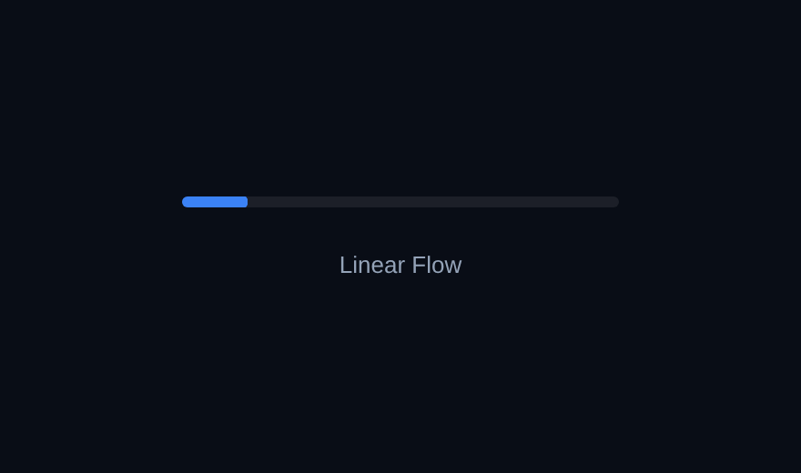 | `--size: 240px; --color: #3b82f6;` | [`pb-linear.html`](loaders/pb-linear.html) |
| **Striped Stream** (`pb-striped`) | 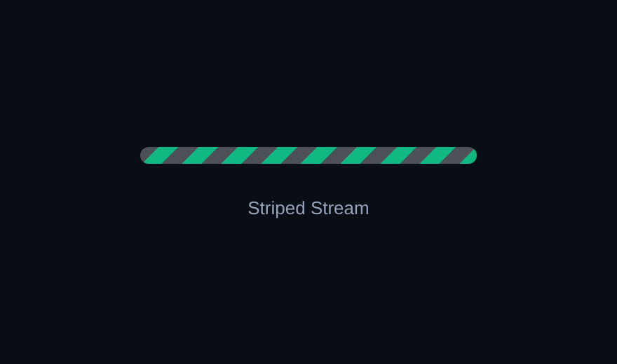 | `--size: 240px; --color: #10b981;` | [`pb-striped.html`](loaders/pb-striped.html) |
| **Segmented LED** (`pb-segmented`) | 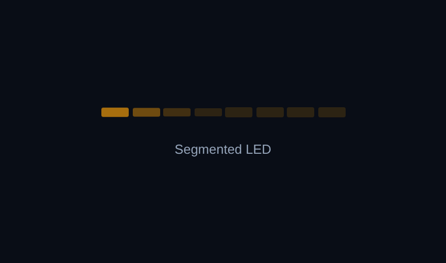 | `--size: 240px; --color: #f59e0b;` | [`pb-segmented.html`](loaders/pb-segmented.html) |
| **Gradient Shimmer** (`pb-gradient-shimmer`) | 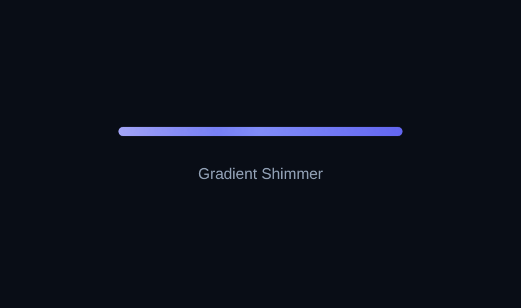 | `--size: 240px; --color: #6366f1;` | [`pb-gradient-shimmer.html`](loaders/pb-gradient-shimmer.html) |
| **Step Checkpoints** (`pb-step-nodes`) | 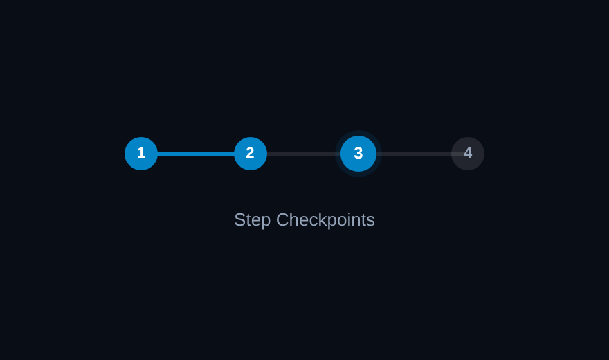 | `--size: 260px; --color: #0284c7;` | [`pb-step-nodes.html`](loaders/pb-step-nodes.html) |
| **Circular Gauge** (`pb-circular-ring`) | 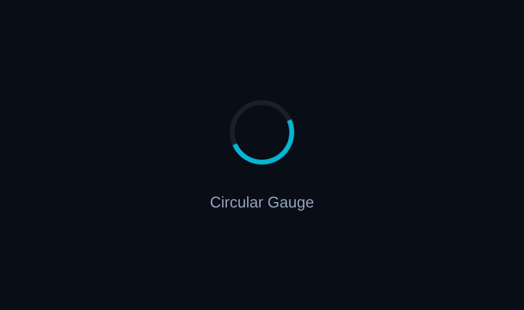 | `--size: 54px; --color: #06b6d4;` | [`pb-circular-ring.html`](loaders/pb-circular-ring.html) |
| **Liquid Tank** (`pb-liquid-wave`) | 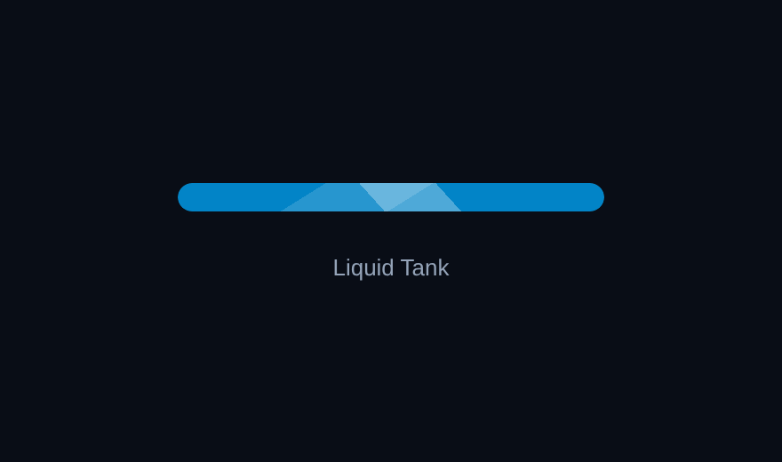 | `--size: 240px; --color: #0284c7;` | [`pb-liquid-wave.html`](loaders/pb-liquid-wave.html) |
| **Laser Beam** (`pb-laser-runner`) | 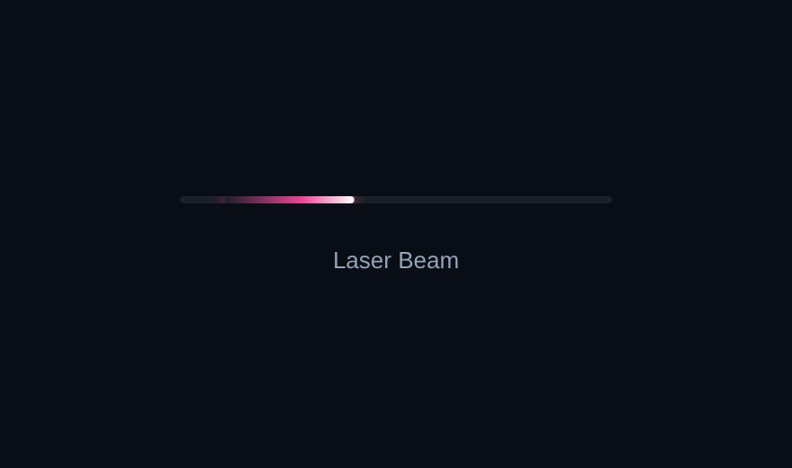 | `--size: 240px; --color: #ec4899;` | [`pb-laser-runner.html`](loaders/pb-laser-runner.html) |
| **Buffer Stream** (`pb-buffered-stream`) | 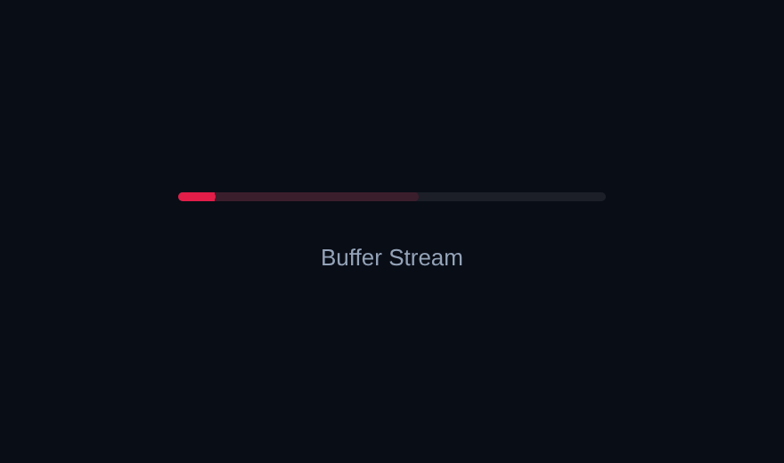 | `--size: 240px; --color: #e11d48;` | [`pb-buffered-stream.html`](loaders/pb-buffered-stream.html) |
| **Magnetic Pill** (`pb-magnetic-pill`) | 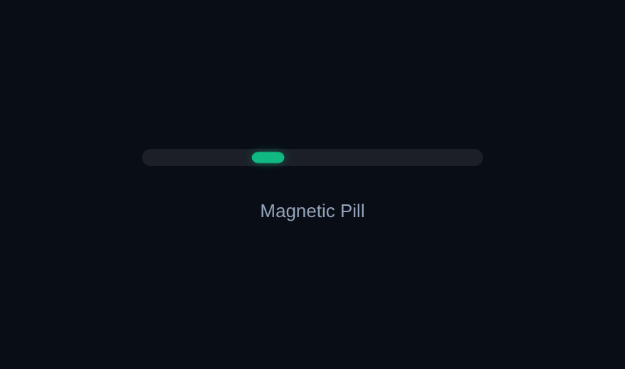 | `--size: 240px; --color: #10b981;` | [`pb-magnetic-pill.html`](loaders/pb-magnetic-pill.html) |

---

### Spinners (10)

| Name | Preview | Variables | File |
|---|:---:|---|---|
| **Dot Ring** (`sp-dots`) | 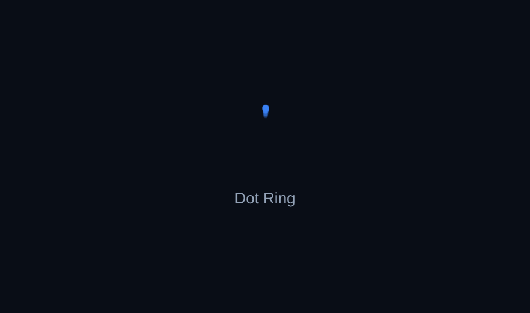 | `--size: 44px; --color: #3b82f6;` | [`sp-dots.html`](loaders/sp-dots.html) |
| **Orbital Core** (`sp-orbit`) | 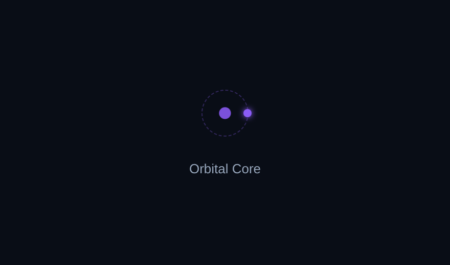 | `--size: 46px; --color: #8b5cf6;` | [`sp-orbit.html`](loaders/sp-orbit.html) |
| **Morphing Shape** (`sp-morph`) | 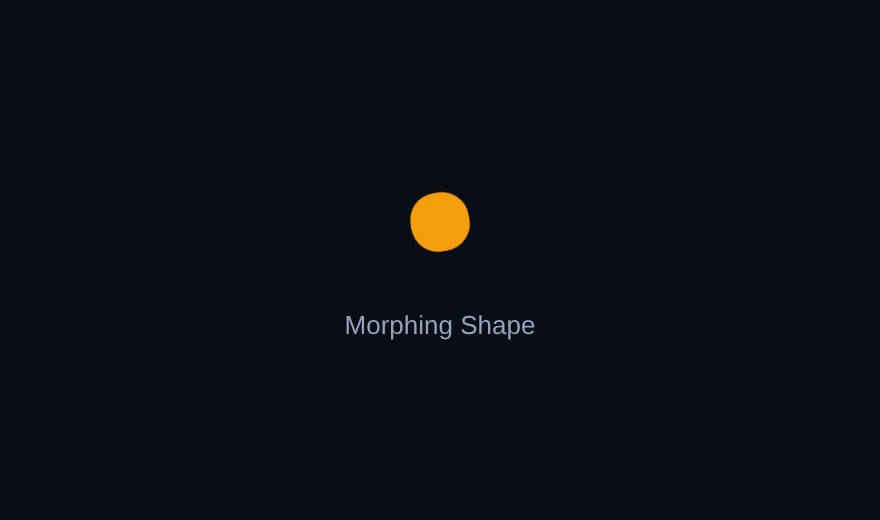 | `--size: 40px; --color: #f59e0b;` | [`sp-morph.html`](loaders/sp-morph.html) |
| **Sonar Pulse** (`sp-pulse`) | 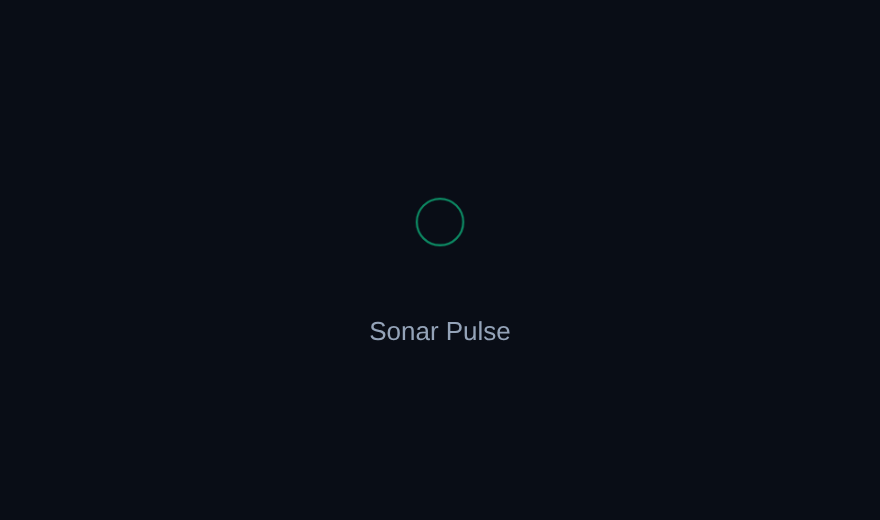 | `--size: 46px; --color: #10b981;` | [`sp-pulse.html`](loaders/sp-pulse.html) |
| **Dual Rings** (`sp-dual-rings`) | 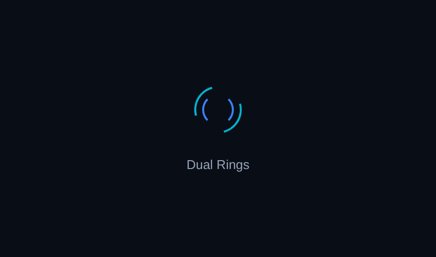 | `--size: 48px; --color: #06b6d4;` | [`sp-dual-rings.html`](loaders/sp-dual-rings.html) |
| **Hourglass** (`sp-hourglass`) | 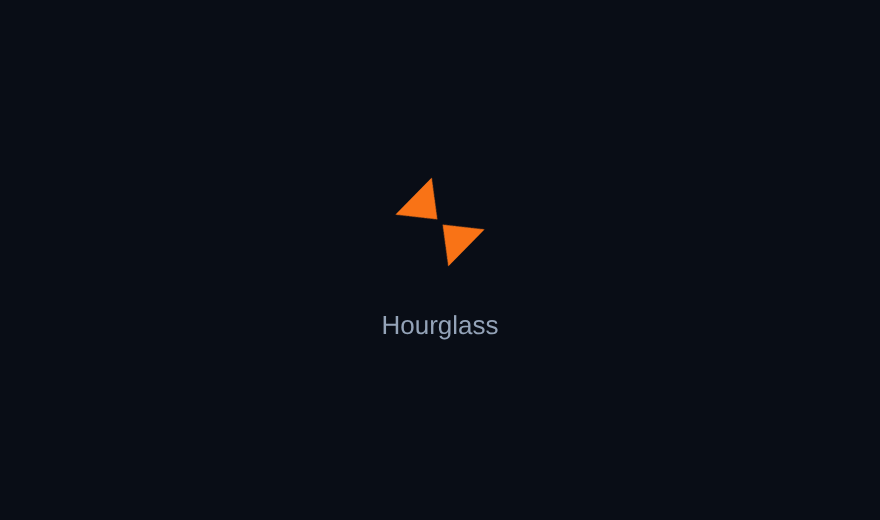 | `--size: 40px; --color: #f97316;` | [`sp-hourglass.html`](loaders/sp-hourglass.html) |
| **Infinity Loop** (`sp-infinity`) | 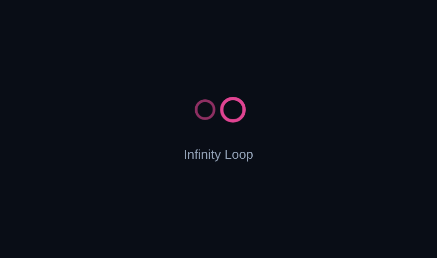 | `--size: 50px; --color: #ec4899;` | [`sp-infinity.html`](loaders/sp-infinity.html) |
| **DNA Helix** (`sp-helix`) | 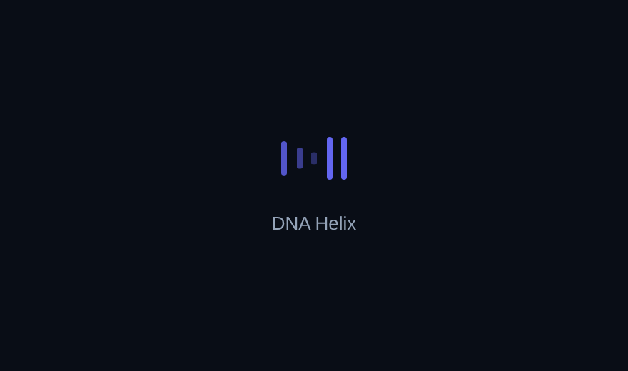 | `--size: 46px; --color: #6366f1;` | [`sp-helix.html`](loaders/sp-helix.html) |
| **Radar Scanner** (`sp-radar`) | 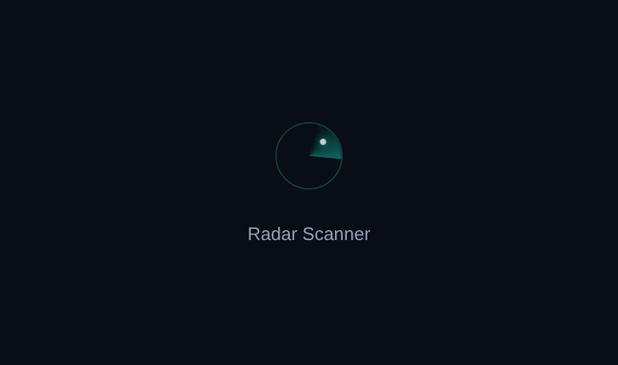 | `--size: 48px; --color: #14b8a6;` | [`sp-radar.html`](loaders/sp-radar.html) |
| **Vortex Arms** (`sp-vortex`) | 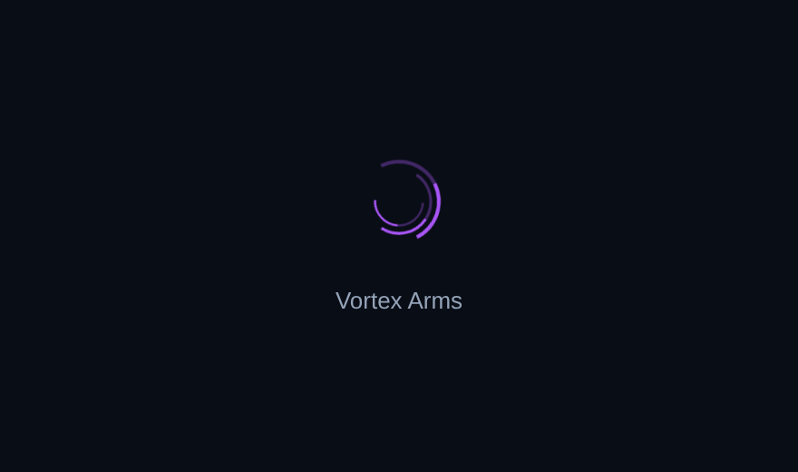 | `--size: 46px; --color: #a855f7;` | [`sp-vortex.html`](loaders/sp-vortex.html) |

---

### Skeleton Screens (5)

| Name | Preview | Variables | File |
|---|:---:|---|---|
| **Card Skeleton** (`sk-card`) |  | `--size: 260px; --color: rgba(255, 255, 255, 0.08);` | [`sk-card.html`](loaders/sk-card.html) |
| **Feed List Skeleton** (`sk-list`) | 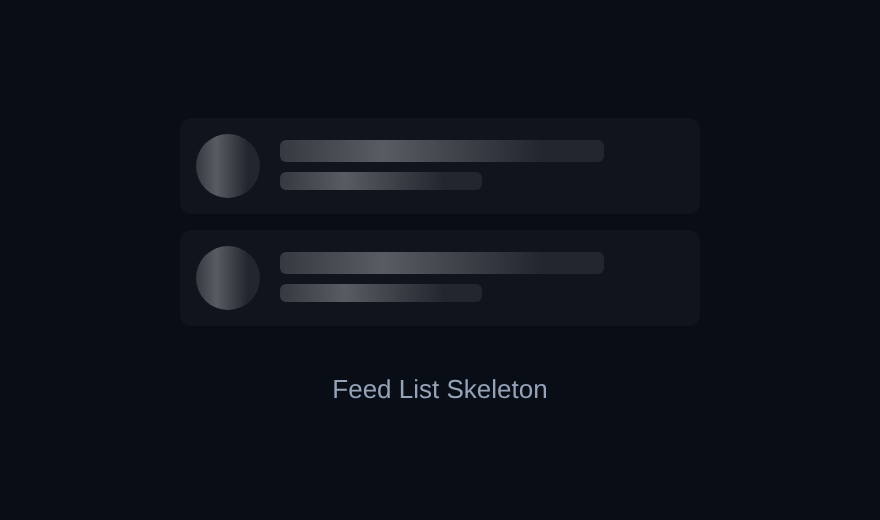 | `--size: 260px; --color: rgba(255, 255, 255, 0.08);` | [`sk-list.html`](loaders/sk-list.html) |
| **Profile Skeleton** (`sk-profile`) | 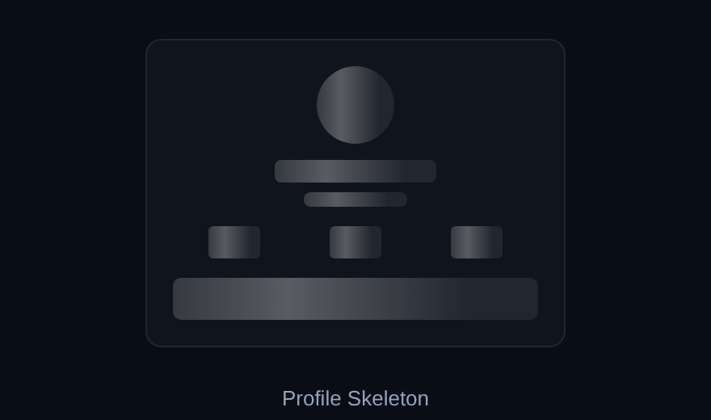 | `--size: 260px; --color: rgba(255, 255, 255, 0.08);` | [`sk-profile.html`](loaders/sk-profile.html) |
| **Table Skeleton** (`sk-table`) | 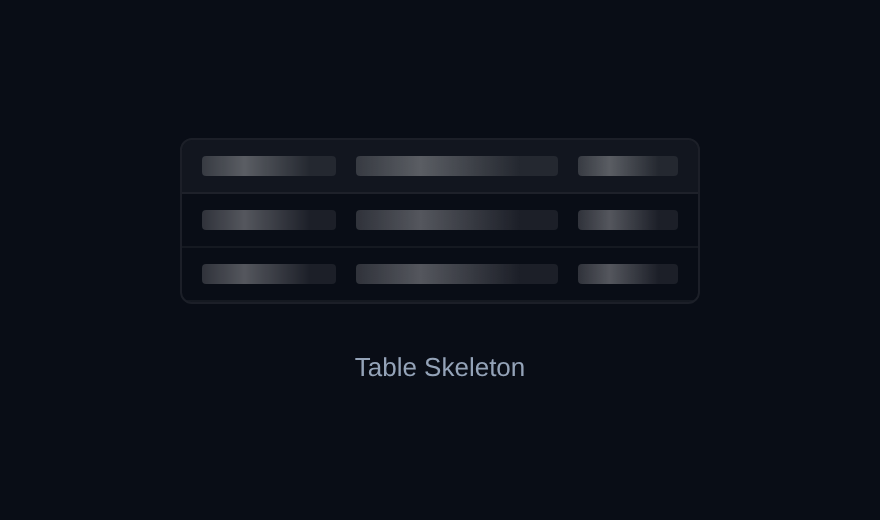 | `--size: 260px; --color: rgba(255, 255, 255, 0.08);` | [`sk-table.html`](loaders/sk-table.html) |
| **Article Skeleton** (`sk-article`) | 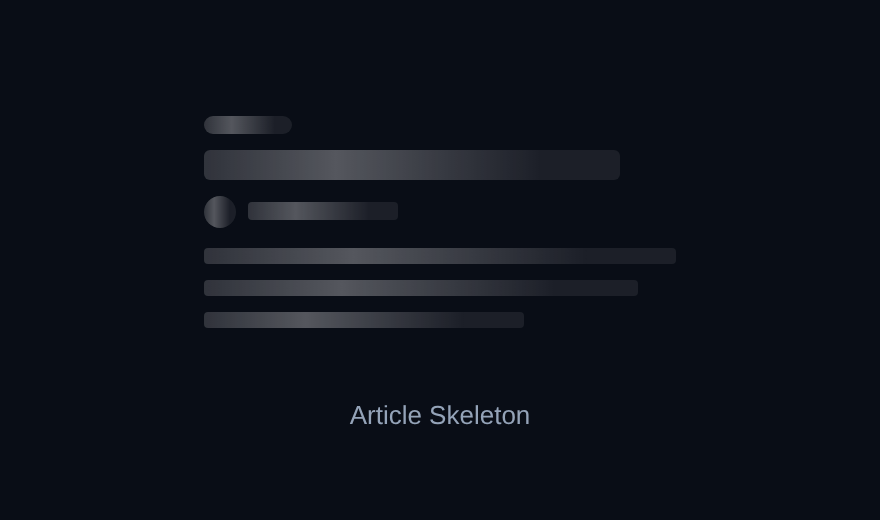 | `--size: 260px; --color: rgba(255, 255, 255, 0.08);` | [`sk-article.html`](loaders/sk-article.html) |

---

### Fun Loaders (5)

| Name | Preview | Variables | File |
|---|:---:|---|---|
| **Typing Bubble** (`fun-typing`) | 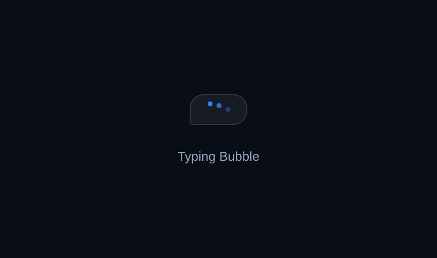 | `--size: 58px; --color: #3b82f6;` | [`fun-typing.html`](loaders/fun-typing.html) |
| **Bouncing Ball** (`fun-bouncing-ball`) | 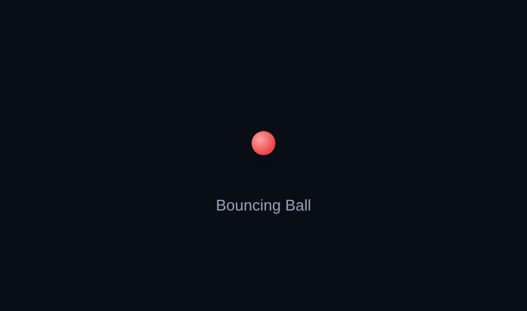 | `--size: 46px; --color: #ef4444;` | [`fun-bouncing-ball.html`](loaders/fun-bouncing-ball.html) |
| **Wave Text** (`fun-wave-text`) | 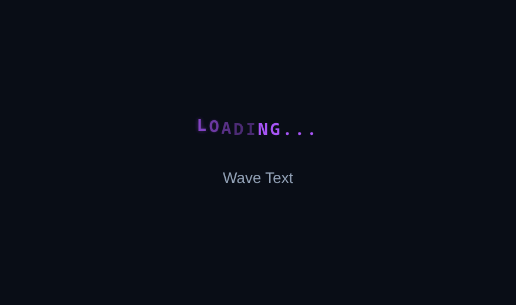 | `--size: 14px; --color: #a855f7;` | [`fun-wave-text.html`](loaders/fun-wave-text.html) |
| **Battery Cell** (`fun-battery`) | 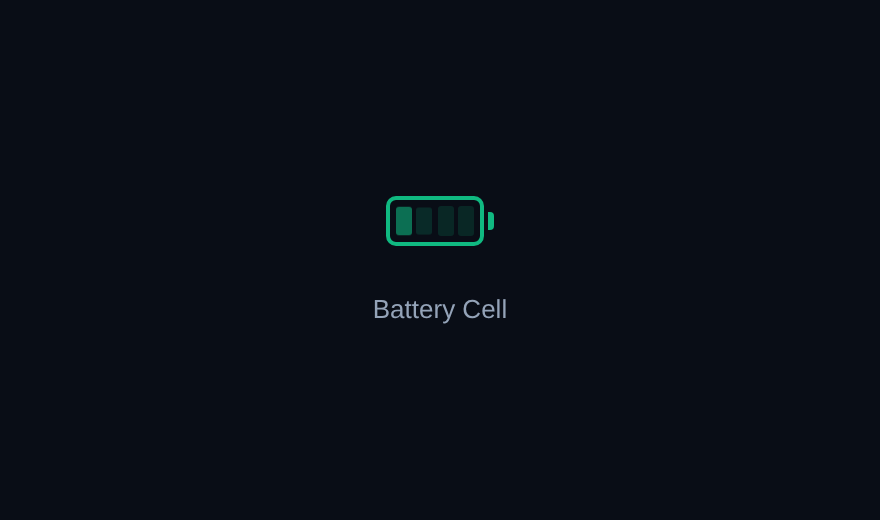 | `--size: 54px; --color: #10b981;` | [`fun-battery.html`](loaders/fun-battery.html) |
| **Pure CSS Rocket** (`fun-rocket`) | 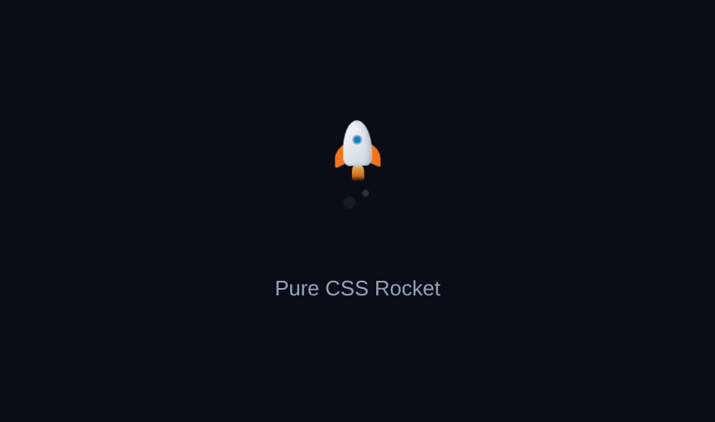 | `--size: 54px; --color: #f97316;` | [`fun-rocket.html`](loaders/fun-rocket.html) |

---

## Local Development

```bash
# Clone the repository
git clone https://github.com/shack-dev-j/loader-lab.git
cd loader-lab

# Install dependencies (Playwright for automated screenshots)
npm install

# Start local preview server
npm start
# Server listens at http://localhost:3000

# Re-run screenshot capture pipeline
npm run screenshots
```

---

## License

[MIT](LICENSE)
